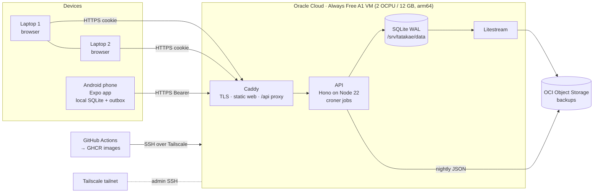

# 03 · Architecture

## System context


## Components
| Component | Responsibility | Lives in |
|---|---|---|
| `packages/core` | Types, Zod schemas, scoring, time (IST, 04:00 day boundary), story picker, sync helpers. Pure TS, runs in Node, browser and React Native. | shared |
| `apps/api` | REST API, auth, sync endpoint, scoring on read, scheduled jobs (backup, optional laptop web push). | VM container `api` |
| `apps/web` | Laptop UI (React + Vite), installable desktop PWA, IndexedDB outbox. | static files in Caddy image |
| `apps/mobile` | Phone UI (Expo Router), local SQLite + outbox, local notifications, focus timer, native integrations (share, widget, usage stats). | APK on the phone |
| Caddy | HTTPS (Let's Encrypt), security headers, SPA fallback, reverse proxy `/api`. | VM container `web` |
| Litestream | Streams SQLite WAL to Object Storage continuously. | VM container `litestream` |
| Terraform + cloud-init | Recreate the whole VM from code. | `infra/terraform`, `deploy/` |

## Data flow: a write on the phone
1. User taps **Done** on P1 → `write("missions", row)`.
2. Row is written to local SQLite and an `outbox` entry is created; UI updates instantly (optimistic).
3. Sync engine flushes when the app is foregrounded, on reconnect, or 2 s after the write: `POST /api/sync { client: "mobile", cursor, items }`.
4. API applies each item with **last-write-wins by `updated_at`**, except server-authoritative fields (plan lock), and returns `applied`, `conflicts`, `changes since cursor`, new `cursor`.
5. Client applies server changes to local DB + query cache; the laptop sees it on its next sync (on focus / visibility change).

## Auth
- Web: `POST /api/session/login { client: "web" }` → HttpOnly Secure SameSite=Lax cookie, 90-day sliding.
- Phone: same endpoint with `client: "mobile"` → token returned in body, stored in `expo-secure-store`, sent as `Authorization: Bearer`.
- Scripts: separate `API_TOKEN` bearer.
- Sessions table lists devices; any can be revoked from Settings. Login is rate-limited. Passkeys for web in v4.

## Time model
All "today" calculations use **Asia/Kolkata** and a **04:00 day boundary** (`todayIST()` in core), so a 01:00 ritual still belongs to the previous day. Never use the container clock directly.

## Notifications
- Phone: **local** scheduled notifications (morning, optional afternoon nudge if P1 not started, ritual reminder). Rescheduled whenever settings or tomorrow's P1 sync. No server push needed.
- Laptop: optional web push (v4) via VAPID.

## Failure modes and answers
| Failure | Effect | Answer |
|---|---|---|
| Phone offline all day | Nothing breaks | Outbox; sync on reconnect |
| VM down / reclaimed | Laptops can't sync; phone keeps working offline | Recreate with Terraform + cloud-init, restore with Litestream (`deploy/scripts/restore.sh`), rehearsed in v4 |
| Bad deploy | API unhealthy | Deploy script health-checks and rolls back to previous image tag |
| Two devices edit same row | Conflict | LWW by `updated_at`; plan lock is server-authoritative; conflicts returned to client and surfaced subtly |
| Domain change | PWA origin changes | Reinstall web app; phone just changes `EXPO_PUBLIC_API_URL` and needs a new build |
| Lost phone | Token exposure | Revoke the device session from a laptop |

## Security
Ports 80/443 only; SSH via Tailscale. Secrets only in `/opt/tatakae/.env` (chmod 600) and GitHub secrets. Argon2id password hash. Session tokens stored hashed. CSP and security headers in Caddy. unattended-upgrades on the VM. No third-party analytics.

## Repository layout
```
apps/web            laptop website
apps/mobile         Android app (Expo)
apps/api            API
packages/core       shared logic
db/                 schema + migrations
deploy/             compose, Caddyfile, litestream, cloud-init, scripts
infra/terraform     OCI resources
references/         story pack format
docs/               you are here
.claude/skills      project-specific Claude Code skills
```
