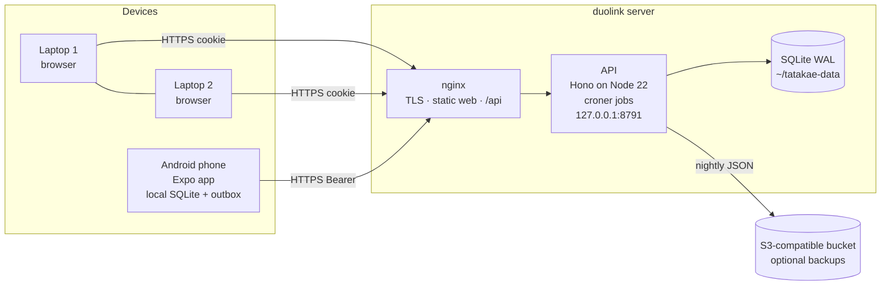

# 03 · Architecture

## System context


## Components
| Component | Responsibility | Lives in |
|---|---|---|
| `packages/core` | Types, Zod schemas, scoring, time (IST, 04:00 day boundary), story picker, sync helpers. Pure TS, runs in Node, browser and React Native. | shared |
| `apps/api` | REST API, auth, sync endpoint, scoring on read, scheduled jobs (backup, optional laptop web push). | the host |
| `apps/web` | Laptop UI (React + Vite), installable desktop PWA, IndexedDB outbox. | static files behind the reverse proxy |
| `apps/mobile` | Phone UI (Expo Router), local SQLite + outbox, local notifications, focus timer, native integrations (share, widget, usage stats). | APK on the phone |

## Data flow: a write on the phone
1. User taps **Done** on P1 → `write("missions", row)`.
2. Row is written to local SQLite and an `outbox` entry is created; UI updates instantly (optimistic).
3. Sync engine flushes when the app is foregrounded, on reconnect, or 2 s after the write: `POST /api/sync { client: "mobile", cursor, items }`.
4. API applies each item with **last-write-wins by `updated_at`**, except server-authoritative fields (plan lock), and returns `applied`, `conflicts`, `changes since cursor`, new `cursor`.
5. Client applies server changes to local DB + query cache; the laptop sees it on its next sync (on focus / visibility change).

## Auth
- Web: `POST /api/session/login { client: "web" }` → HttpOnly Secure SameSite=Lax cookie, 90-day sliding.
- Phone: same endpoint with `client: "mobile"` → token returned in body, stored in `expo-secure-store`, sent as `Authorization: Bearer`.
- Scripts: log in with `client: "mobile"` and use that session's bearer (there is no static API token, so every caller shows in Devices and can be revoked).
- Step-up: adding a passkey, signing out another device and the full export need a password or passkey check from the last 10 minutes (`sessions.auth_at`). Otherwise the API answers 403 `reauth_required`; the website opens "Confirm it's you" (password or passkey), the phone shows an inline password field, then the call is retried. `POST /api/session/reauth { password }` / `POST /api/passkeys/reauth`; a wrong answer is 403, never 401, so the device stays signed in.
- Sessions table lists devices; any can be revoked from Settings. Login is rate-limited. Passkeys for web in v4: `POST /api/passkeys/login` (discoverable credential, no email) gives the same cookie; the password stays as the fallback.

## Time model
All "today" calculations use **Asia/Kolkata** and a **04:00 day boundary** (`todayIST()` in core), so a 01:00 ritual still belongs to the previous day. Never use the container clock directly.

## Notifications
- Phone: **local** scheduled notifications (morning, optional afternoon nudge if P1 not started, ritual reminder). Rescheduled whenever settings or tomorrow's P1 sync. No server push needed.
- Laptop: optional web push (v4) via VAPID.

## Failure modes and answers
| Failure | Effect | Answer |
|---|---|---|
| Phone offline all day | Nothing breaks | Outbox; sync on reconnect |
| Host down | Laptops can't sync; phone keeps working offline | Restore the volume snapshot or the nightly JSON export on a new host; devices resync |
| Two devices edit same row | Conflict | LWW by `updated_at`; plan lock is server-authoritative; conflicts returned to client and surfaced subtly |
| Domain change | PWA origin changes | Reinstall web app; phone just changes `EXPO_PUBLIC_API_URL` and needs a new build |
| Lost phone | Token exposure | Revoke the device session from a laptop |

## Security
Argon2id password hash. Session tokens stored hashed. No third-party analytics. TLS, security headers and a request size cap belong to whatever reverse proxy the host uses (`deploy/Caddyfile.local` shows the routing for the local run).

In the API itself (so it carries over to any host): step-up re-auth for sensitive actions (above); per-IP login limits plus at most 30 wrong passwords an hour overall; request body caps per path; cookie writes refused when `Origin` / `Sec-Fetch-Site` say another site; `__Host-` session cookie in production; production refuses `DEV_BYPASS_AUTH=1`; a changed login in `.env` signs every device out on boot; `security_events` logs sign-ins and security changes (Settings → Devices). Clients: "Sign out and erase" wipes the local copy; the phone is excluded from Android backup and only takes signed EAS updates. CI: OSV, gitleaks and CodeQL (`security.yml`), Dependabot, actions pinned to SHAs.

## Repository layout
```
apps/web            laptop website
apps/mobile         Android app (Expo)
apps/api            API
packages/core       shared logic
db/                 schema + migrations
deploy/             local Docker run, Caddyfile.local, hash-password.sh
references/         story pack format
docs/               you are here
.claude/skills      project-specific Claude Code skills
```
